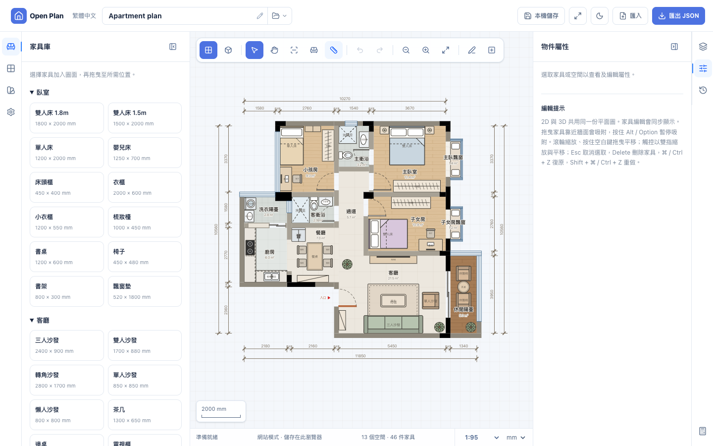
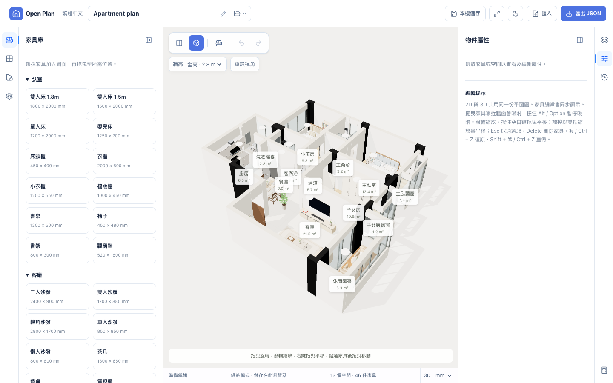

# Open Plan

A floor-plan editor (2D and 3D) that runs on your own computer, with tools that let an AI agent make and change the plan.

You give an image of a floor plan to your own AI agent. The agent writes the plan as a JSON file. Open Plan checks the file, shows it in 2D and 3D, and lets you correct it.





## What it is for

- **For a person:** get a plan from an image without drawing each wall by hand, then correct the scale and the geometry in the editor.
- **For an agent:** a command line tool (CLI) and a local MCP server that validate, draw and change a plan file. The editor in the browser shows the same file live, so the person sees each change of the agent.

Open Plan uploads nothing. The editor, the CLI and the MCP server run on your computer, and they do not send your image or your plan to a server. Your AI agent is a separate program: when you give it an image, the agent processes the image by its own rules.

## Status

Open Plan is a personal project in an early state (version 0.1.0).

- **You run it from this repository.** There is no npm package and no hosted website.
- **Tested on macOS with Node 24 only.** Linux and Windows are not tested.
- **Tested with two agents:** Claude Code and Codex. Other agents are not tested.
- **Only horizontal and vertical walls.** A plan with diagonal walls must be approximated.
- **The user interface is in Traditional Chinese (zh-TW).** The docs and the agent guide are in English.

A plan that passes `validate` has a correct format. That is not proof that the plan agrees with the image: an agent can read a scale, a door or a wall incorrectly. Compare the drawing with the source image.

## Quick start

You need [Node.js](https://nodejs.org) 24 and [pnpm](https://pnpm.io) 11. These are the tested versions (Node 24.21 and pnpm 11.24.0); other versions are not tested.

```sh
git clone https://github.com/tyc67/open-plan.git
cd open-plan
pnpm install
pnpm dev
```

`pnpm dev` starts the editor in **website mode**: the plan is stored in your browser. A new user gets an empty plan with two actions: import a plan file, or load the sample apartment.

To work on a plan **file**, which is the mode that an agent uses:

```sh
pnpm build
node packages/cli/dist/cli.js new plan.json --sample    # without --sample: an empty plan
node packages/cli/dist/cli.js serve plan.json
```

`serve` opens the editor on `127.0.0.1`, with a secret token in the link (the option `--host` adds one more address, with plain HTTP). Finished edits are saved to the file automatically, and a change that an agent makes to the file shows in the editor. Backups are kept in a folder beside the plan file.

## Make a plan from an image

Build first (`pnpm build`). The commands below are written for the root folder of this repository; from another folder, use the full path of `packages/cli/dist/cli.js`.

1. Start your AI agent in a folder with the image, and give it the Open Plan guide: `node packages/cli/dist/cli.js guide` prints it. Ready-made instruction files are in [`examples/agents/`](examples/agents/).
2. Ask the agent to make `plan.json` from the image. The guide tells it the format, the rules and the work loop: write the file, `validate` it, `render` it to a PNG, compare the PNG with the image, and correct the file.
3. Open the result: `node packages/cli/dist/cli.js serve plan.json`, or import the file in website mode.
4. Correct it in the editor. Start with the scale: measure a length that you know, type its real value, and the whole plan is scaled.

## What the editor does

- **2D and 3D:** the same plan as an SVG drawing and as a Three.js view. Walls are centre lines with a thickness. Doors, windows, sliding doors and empty openings belong to a wall.
- **Import with checks:** an import is validated first. Each error shows the path of the field, so you can paste the errors to your agent. The open plan is backed up before it is replaced.
- **Scale correction:** from one known length.
- **Editing:** walls (type, thickness, length, split, join, reverse, add, delete, demolition mark), openings (type, position, width, heights, hinge and swing, move to another wall), rooms (outline points, name, floor material), furniture, measurements, a cost estimate, undo and redo.
- **Two storage modes:** website mode keeps one plan in the browser. File mode (`serve`) keeps the plan in a file on your computer. Export and import move a plan between the modes.

## For agents

The CLI has these commands: `guide`, `schema`, `validate`, `info`, `new`, `migrate`, `apply`, `render`, `serve`, `mcp`, `backups` and `restore`. `node packages/cli/dist/cli.js --help` describes each one.

- **The guide:** `node packages/cli/dist/cli.js guide` (forms: `text`, `agents-md`, `skill`, `llms`, `mcp`). Its sources are in [`docs/agent-guide/`](docs/agent-guide/).
- **The format:** [`docs/plan-format.md`](docs/plan-format.md) and the JSON Schema [`docs/open-plan.schema.json`](docs/open-plan.schema.json).
- **Changes as commands:** `apply` runs a batch of commands on a plan file, for example `add_wall`, `move_opening` or `set_dimensions`. A batch is atomic, and it needs the revision of the plan that the agent read, so a change of the user is not overwritten. There are 26 commands; the reference is [`docs/agent-guide/commands.md`](docs/agent-guide/commands.md).
- **The MCP server:** `node packages/cli/dist/cli.js mcp --root <folder>` (stdio, 10 tools). It works only on files in the root folder. This boundary protects against mistakes and existing links; it is not a defence against a hostile program on the same computer.

## How the repository is organized

| Folder | Contents |
|---|---|
| `packages/core/` | TypeScript. The plan types, the validator, geometry, the editing commands and the 2D drawing. |
| `packages/cli/` | TypeScript. The CLI, `serve` (file mode) and the MCP server. Its build includes the built editor. |
| `apps/web/` | The editor: Vite, React and Three.js, in JavaScript. |
| `docs/` | The plan format and schema, the agent guide, and the work records of the project. |
| `examples/agents/` | Instruction files for agents. |
| `tools/` | Browser checks and screenshot compares. |

[`docs/plan-import-roadmap.md`](docs/plan-import-roadmap.md) and [`docs/feature-review.md`](docs/feature-review.md) are the work records of the project: the plan, the decisions with their dates, the known limits and the defects that were found. They are long, and they were written during the work, not as an introduction.

## Tests

```sh
pnpm test         # Vitest: core, CLI and web logic (the first step builds the CLI and the web app)
pnpm typecheck    # the core and the CLI; the web app is JavaScript and has no typecheck
```

The browser checks need Google Chrome (set `CHROME_PATH` for another location) and a build (`pnpm build`).

```sh
# against the built `serve`
for c in serve mcp-serve scale walls openings-edit rooms-edit edit-gestures; do node tools/checks/$c.mjs; done

# against a web server
pnpm --filter open-plan-web exec vite preview --port 4319 --strictPort &
for c in session save-on-hide tabs demolition replace import validation openings bounds; do node tools/checks/$c.mjs http://localhost:4319/; done
```

Screenshots: `node tools/visual/capture.mjs <url> <out-dir>`, then `node tools/visual/compare.mjs <baseline-dir> <out-dir>`. The baseline screenshots are not in the repository.

## Origin

The project started from the Mamezu codebase (workspace shell, panels, toolbar).

## Licence

[MIT](LICENSE).

The test font in `packages/cli/test/fonts/` is a subset of Noto Sans TC under the SIL Open Font License 1.1 (`OFL.txt` in that folder). The CLI build writes the notices of its bundled npm packages to `packages/cli/dist/THIRD-PARTY-NOTICES.txt`.
